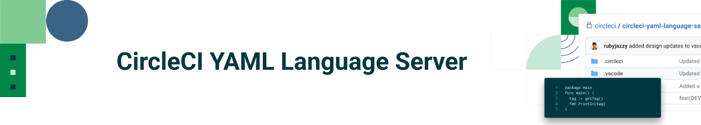
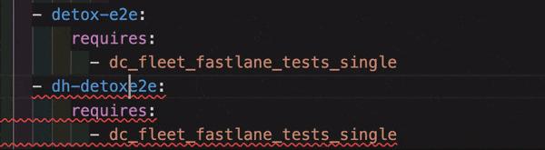
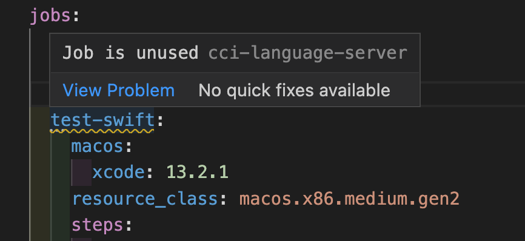
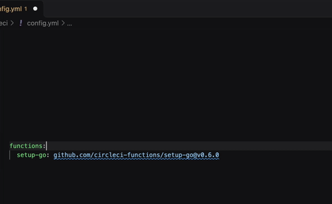
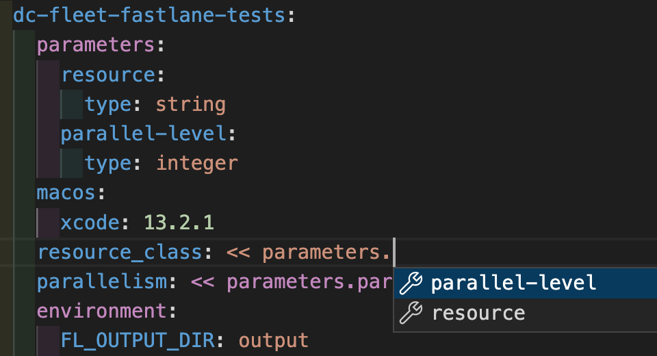
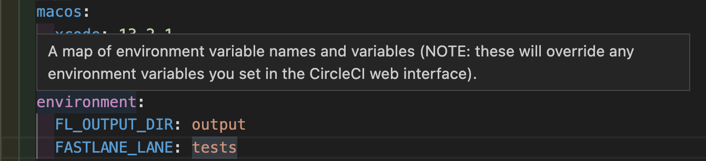
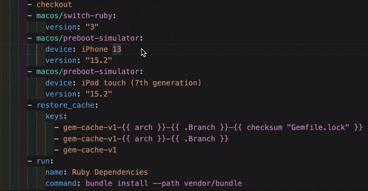
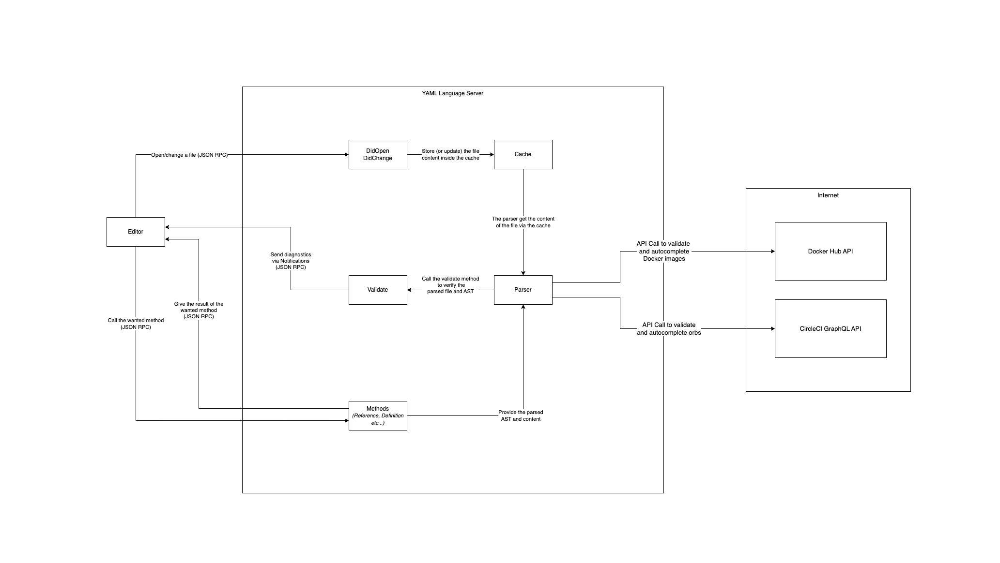

# CircleCI YAML Language Server

[](https://dl.circleci.com/status-badge/redirect/gh/CircleCI-Public/circleci-yaml-language-server/tree/main)
[](https://github.com/circleci-public/circleci-yaml-language-server/releases)
[](./LICENSE.md)

A [Language Server Protocol](https://microsoft.github.io/language-server-protocol/)
server for CircleCI configuration files. It brings validation, completion,
hover documentation, navigation and refactoring for `.circleci/config.yml` to
any editor with an LSP client.

It powers the config helper in CircleCI's
[VS Code extension](https://marketplace.visualstudio.com/items?itemName=circleci.circleci)
and [JetBrains plugin](https://plugins.jetbrains.com/plugin/34719-circleci),
and it's open source so that it can be used from any other editor, and so that
the community can see how it works and help improve it.

## Features

### Validation

Errors and warnings as you type: unknown keys, wrong types, missing
parameters, undefined jobs, commands and executors, unused definitions,
deprecated keys and images, Docker image tags and orb versions that don't
exist, and more. Orbs are fetched so that what they define is checked too.

<p align="center">
    
</p>

<p align="center">
    
</p>

### Quick fixes

Code actions fix common problems, such as updating an orb to its latest
version, replacing a deprecated machine image, or moving a Docker image to a
tag that exists.

Any diagnostic can also be suppressed with a comment, and a quick fix inserts
it for you:

- `# cci-ignore`: on the same line
- `# cci-ignore-next-line`: on the next line
- `# cci-ignore-start` / `# cci-ignore-end`: in a range
- `# cci-ignore-file`: in the whole file

<p align="center">
    
</p>

### Completion

Built-in keys and their values, and the names the config defines: jobs,
commands, executors, parameters, orbs and their commands, plus contexts,
pipeline values, Docker images, resource classes, machine images and Xcode
versions.

<p align="center">
    
</p>

### Hover

On a key, its documentation from the
[configuration reference](https://circleci.com/docs/reference/configuration-reference/).
On a name, what it refers to: a job, command, executor, orb, parameter or
pipeline value.

<p align="center">
    
</p>

### Navigation and refactoring

- Go to definition and find references for jobs, commands, executors and
  parameters, including into the source of orbs
- Rename a job, command or executor everywhere it's used
- Highlight every use of the name under the cursor
- Document and workspace symbols, for outlines and "go to symbol"
- Links from orbs and Docker images to their pages in the orb registry and on
  Docker Hub
- Inlay hints showing the version an orb resolves to, and how many jobs a
  matrix expands to
- Semantic highlighting of keywords, parameters and orbs

<p align="center">
    
</p>

## Installation

### VS Code and JetBrains IDEs

Install the CircleCI
[VS Code extension](https://marketplace.visualstudio.com/items?itemName=circleci.circleci)
or [JetBrains plugin](https://plugins.jetbrains.com/plugin/34719-circleci).
Both run the language server for you.

### Other editors

Download the archive for your platform from the
[latest release](https://github.com/CircleCI-Public/circleci-yaml-language-server/releases/latest),
such as `circleci-yaml-language-server_<version>_darwin_arm64.tar.gz`. Put the
`circleci-yaml-lsp` binary inside it on your `PATH`, then point your editor's
LSP client at it with the `-stdio` flag:

```sh
circleci-yaml-lsp -stdio
```

The server only handles files in a `.circleci` directory, so it's safe to
attach it to every YAML file. Other YAML files, such as GitHub workflows and
Kubernetes manifests, are left alone.

| Flag | Meaning |
| --- | --- |
| `-stdio` | Talk LSP over stdin and stdout. This is what most editors expect. |
| `-host`, `-port` | Listen on a TCP socket instead. They can also be set with `LSP_SERVER_HOST` and `PORT`. |
| `-debug=false` | Only log at info and above. Logs go to stderr. |
| `-schema <path>` | Use this JSON schema instead of the one built in. Also `SCHEMA_LOCATION`. |
| `-version` | Print the version and exit. |

## Editor setup

| Editor | Client |
| --- | --- |
| VS Code | [CircleCI extension](https://marketplace.visualstudio.com/items?itemName=circleci.circleci) |
| JetBrains IDEs | [CircleCI plugin](https://plugins.jetbrains.com/plugin/34719-circleci) ([source](https://github.com/CircleCI-Public/circleci-jetbrains-plugin)) |
| Emacs | [circleci-yaml-mode](./editors/emacs/circleci-yaml-mode.el), for eglot or lsp-mode. It downloads the server too. |
| Neovim | [circleci.nvim](https://github.com/tomoakley/circleci.nvim) (community), or the built-in client below |

### Neovim (0.11+)

```lua
vim.lsp.config('circleci', {
  cmd = { 'circleci-yaml-lsp', '-stdio' },
  filetypes = { 'yaml' },
  root_markers = { '.circleci', '.git' },
})
vim.lsp.enable('circleci')
```

### Writing a client

To integrate the server with another editor or a coding agent, see
[ADD_A_CLIENT.md](./ADD_A_CLIENT.md). It covers initialization options,
authentication commands and the custom requests the server makes. If you
publish a client, open an issue and we'll add it here.

## Authentication

Most features work without credentials. Some need them:

- **CircleCI**: private orbs, contexts and project settings need a
  [personal API token](https://app.circleci.com/settings/user/tokens). The VS
  Code extension and JetBrains plugin send it when you sign in. Other clients send it with the
  `setToken` command. CircleCI Server users also send their host with
  `setSelfHostedUrl`.
- **GitHub**: orbs referenced by the URL of a file in a private GitHub
  repository are fetched with `GH_TOKEN` or `GITHUB_TOKEN` from the server's
  environment, or a token the client sends with `setGitHubToken`.

## JSON schema

The validation schema, [`schema.json`](./schema.json), is built into the
server. It's also published on
[SchemaStore](https://www.schemastore.org/), so editors with a YAML extension,
such as Red Hat's for VS Code, get basic validation and hover docs for
CircleCI config even without this server.

## <a name="contributing"></a>Contributing

Please feel free to contribute to this project, we update our Hall of fame -
[CONTRIBUTORS.md](./CONTRIBUTORS.md) with all contributors who helped us fix a
bug. You can find all the contribution guidelines and useful information in
[CONTRIBUTING.md](./CONTRIBUTING.md). Development instructions for the CircleCI
YAML Language Server can be found in [HACKING.md](HACKING.md).

## <a name="architecture"></a>Architecture diagram



## <a name="quicklinks"></a>Quick links

- [Install the VS Code extension using our language server](https://marketplace.visualstudio.com/items?itemName=circleci.circleci)

- [Discover how the language server was leveraged for the VS Code extension](https://youtu.be/Sdi7ctAXe2A)

- [Learn more about CircleCI](https://circleci.com/)

- [Do you have questions? Ask the circleCI community Discuss](https://discuss.circleci.com/)
